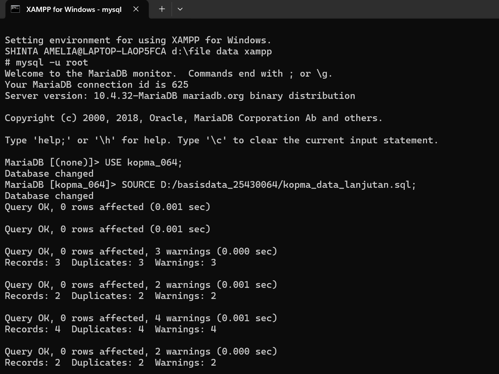
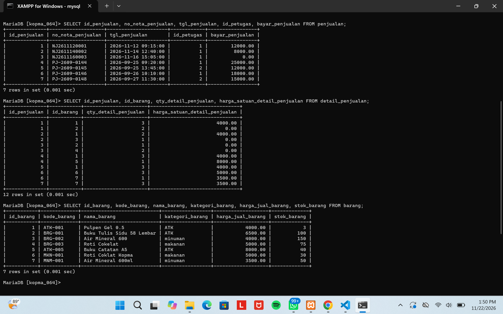
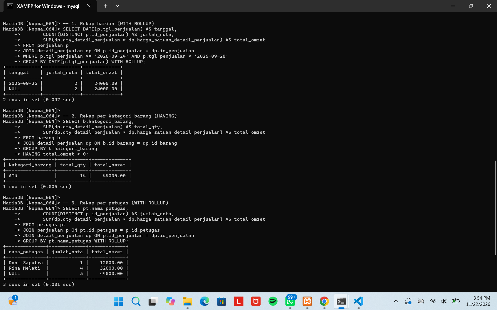
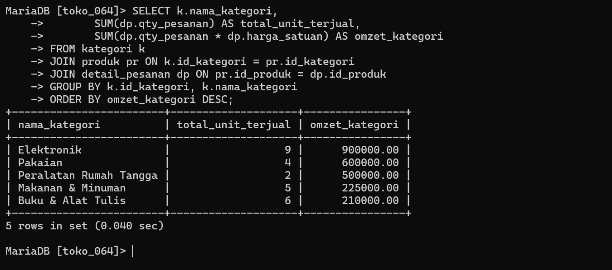

# Laporan Praktikum Basis Data
Nama: Shinta Amelia

NPM: 25430064

Kelas: C

Program Studi: S1 Ilmu Komputer

Pertemuan: 9

Tanggal: 22 November 2026

## 1. Tujuan Praktikum
1. Memahami dan menerapkan pengelompokan baris data menggunakan klausa `GROUP BY` dan fungsi agregasi (`COUNT`, `SUM`) pada basis data `kopma_064`.
2. Menerapkan mode ketat `ONLY_FULL_GROUP_BY` agar kueri agregasi berjalan konsisten sesuai standar SQL.
3. Menyaring hasil pengelompokan data menggunakan klausa `HAVING`.
4. Menampilkan baris ringkasan total (*grand total*) secara otomatis menggunakan `WITH ROLLUP`.

## 2. Ringkasan Dasar Teori
* **Clausa `GROUP BY` & Fungsi Agregasi:** Mengelompokkan baris data yang memiliki nilai sama pada kolom tertentu untuk dihitung ringkasannya menggunakan fungsi seperti `COUNT(DISTINCT ...)` dan `SUM(...)`.
* **Mode `ONLY_FULL_GROUP_BY`:** Mode SQL pada MariaDB/MySQL yang mewajibkan kolom non-agregat pada `SELECT` tercantum jelas dalam klausa `GROUP BY` agar hasil agregasi tidak ambigu.
* **Clausa `HAVING`:** Digunakan untuk menyaring kelompok hasil agregasi setelah proses `GROUP BY` dan fungsi agregat dihitung (berbeda dari `WHERE` yang menyaring baris sebelum pengelompokan).
* **Modifikasi `WITH ROLLUP`:** Menambahkan baris ringkasan subtotal maupun total keseluruhan (`NULL`) pada hasil pengelompokan `GROUP BY`.

## 3. Hasil Langkah Percobaan
- Pemuatan Data Lanjutan: Berhasil menjalankan skrip `kopma_data_lanjutan.sql` dari jalur absolut `D:/basisdata_25430064/kopma_data_lanjutan.sql` ke basis data `kopma_064` melalui *client* MariaDB di XAMPP Shell.
- Verifikasi Isi Tabel: Berhasil mengecek isi tabel `penjualan` (7 baris), `detail_penjualan` (12 baris), dan `barang` (7 baris) untuk memastikan data transaksi dan rincian barang lengkap.
- Pengujian Agregasi: Berhasil menjalankan kueri rekap harian dengan `GROUP BY DATE(p.tgl_penjualan) WITH ROLLUP`, rekap per kategori barang dengan `GROUP BY b.kategori_barang HAVING total_omzet > 0`, serta rekap per petugas dengan `GROUP BY pt.nama_petugas WITH ROLLUP`.

Bukti Pemuatan Data Lanjutan:

Bukti Pengecekan Isi Tabel:

Bukti Kueri Agregasi dan Rekap Omzet Kopma:

## 4. Jawaban Titik Analisis
1. **Titik Analisis 1:** Penggunaan `COUNT(DISTINCT p.id_penjualan)` saat menghitung jumlah nota mencegah terjadinya penghitungan ganda ketika satu nota penjualan memiliki lebih dari satu baris pada `detail_penjualan`.
2. **Titik Analisis 2:** Klausa `HAVING total_omzet > 0` menyaring kelompok setelah fungsi agregasi `SUM(...)` dihitung, sehingga hanya kategori dengan omzet di atas nol (`ATK`, `makanan`, dan `minuman`) yang ditampilkan.
3. **Titik Analisis 3:** Pada hasil `WITH ROLLUP`, baris dengan nilai `NULL` pada kolom pengelompokan menunjukkan total keseluruhan dari kelompok di atasnya (pada rekap harian `2026-09-24` s.d. `< 2026-09-28` tercatat 4 nota dengan total omzet `61000.00`, sedangkan pada rekap per petugas tercatat total 7 nota dengan omzet `81000.00`).

## 5. Hasil Latihan dan Modifikasi
1. Menambahkan data transaksi lanjutan ke basis data `kopma_064` melalui skrip `kopma_data_lanjutan.sql` tanpa menimpa data awal.
2. Menguji pengelompokan data berdasarkan tiga sudut pandang berbeda: tanggal transaksi (`WITH ROLLUP`), kategori barang (`HAVING`), dan nama petugas kasir (`WITH ROLLUP`).

## 6. Tugas Mandiri: Penerapan Agregasi Data (`kopma_064` & `toko_064`)
- **Basis Data Utama:** `kopma_064` (rekap penjualan harian, kategori barang, dan petugas).
- **Penerapan pada Proyek `toko_064`:** Melakukan kueri agregasi `GROUP BY` dan `ORDER BY omzet_kategori DESC` untuk menghitung total unit terjual dan omzet per kategori (`Elektronik`, `Pakaian`, `Peralatan Rumah Tangga`, `Makanan & Minuman`, dan `Buku & Alat Tulis`).

Bukti Rekap Omzet per Kategori Toko:

## 7. Pembahasan dan Kendala
Kendala awal terkait *path* berkas saat pemanggilan `SOURCE` dan kelengkapan data transaksi pada rentang tanggal serta kategori barang teratasi setelah menggunakan jalur absolut `D:/basisdata_25430064/kopma_data_lanjutan.sql` dan memverifikasi ulang hasil `SELECT` serta kueri agregasi di MariaDB.

## 8. Kesimpulan
Modul 9 berhasil diselesaikan dengan baik. Klausa `GROUP BY` bersama fungsi agregasi (`COUNT`, `SUM`), klausa `HAVING`, dan `WITH ROLLUP` dapat digunakan untuk menyajikan ringkasan transaksi dan total omzet secara terstruktur pada basis data `kopma_064` maupun `toko_064`.

## 9. Pernyataan Penggunaan AI
Penggunaan AI (Gemini) dimanfaatkan untuk membantu menyusun skrip data lanjutan, mengecek hasil kueri agregasi, serta merapikan struktur laporan praktikum.

## 10. Bukti Git
- **Tautan Repositori:** https://github.com/shintaamelia64/BasisData_25430064.git
- **Commit / Keterangan:** 

## Checklist
- [x] Penamaan file screenshot sudah rapi dan sesuai dengan tautan di laporan
- [x] Skrip data lanjutan dan kueri agregasi berjalan tanpa error
- [x] Tangkapan layar hasil pengujian terlampir di laporan
- [x] Laporan disusun berurutan dan menggunakan identitas NPM yang sesuai